# Práctica: Administración de Contenedores con Dokploy PaaS

**Universidad del Quindío**  
**Facultad de Ingeniería de Sistemas y Computación**  
**Curso:** Administración de Infraestructura de TI  
**Estudiante:** Samuel (samuel26zc)  
**Repositorio GitHub:** [https://github.com/samuel26zc/dokploy-practica](https://github.com/samuel26zc/dokploy-practica)

---

## 📌 Descripción del Proyecto

Este repositorio contiene la aplicación Node.js / Express y las configuraciones de infraestructura correspondientes a la práctica integral de **Administración de Contenedores y Plataformas PaaS con Dokploy**.

Dokploy es una plataforma PaaS (Platform as a Service) auto-hospedada moderna que automatiza la orquestación de contenedores, enrutamiento dinámico mediante Traefik v3, aprovisionamiento de bases de datos relacionales y NoSQL, monitoreo de métricas en tiempo real y despliegue continuo (CI/CD) conectado a Git.

---

## 📁 Estructura del Repositorio

```bash
dokploy-practica/
├── .dockerignore           # Exclusión de archivos temporales y node_modules
├── .env                    # Variables de entorno de referencia para despliegue
├── docker-compose.yml      # Stack multi-servicio (Fase 5: Node.js, Mongo, MySQL, phpMyAdmin)
├── package.json            # Metadatos del proyecto y dependencias (Express, mysql2)
├── README.md               # Documentación completa del proyecto
└── src/
    └── index.js            # Servidor API Express con endpoints de estado y salud (v2.0.0)
```

---

## 🚀 Endpoints de la Aplicación

La aplicación expone tres endpoints HTTP principales en formato JSON:

1. **`GET /`**:
   - **Propósito:** Endpoint raíz con información institucional, versión actual y confirmación de despliegue automatizado.
   - **Respuesta de ejemplo:**
     ```json
     {
       "mensaje": "¡Aplicación actualizada automáticamente con Dokploy CI/CD!",
       "version": "2.0.0",
       "institucion": "Universidad del Quindío",
       "programa": "Ingeniería de Sistemas y Computación",
       "curso": "Administración de Infraestructura de TI",
       "plataforma": "Dokploy PaaS Self-Hosted",
       "despliegue": "Automático vía Git Webhook CI/CD",
       "fecha": "2026-10-31T19:13:50.838Z"
     }
     ```

2. **`GET /health`**:
   - **Propósito:** Healthcheck utilizado por el orquestador y proxies inversos para verificar disponibilidad.
   - **Respuesta:** Estado de salud (`saludable`), uptime en segundos y versión de Node.js en ejecución.

3. **`GET /info`**:
   - **Propósito:** Información técnica de entorno de ejecución, arquitectura de CPU, memoria RAM disponible y configuración de variables de entorno activas.

---

## ⚙️ Variables de Entorno Configuradas en Dokploy

| Variable | Valor de Configuración | Descripción |
|---|---|---|
| `NODE_ENV` | `production` | Modo de ejecución optimizado de Node.js |
| `PORT` | `3000` | Puerto interno de escucha del servidor HTTP |
| `APP_NAME` | `webapp-uni-quindio` | Identificador de servicio en Dokploy |
| `APP_VERSION` | `2.0.0` | Versión del artefacto en producción |
| `DB_HOST` | `uniquindio-dbuniquindio-t5ksjq` | Host interno de red Docker para MySQL |
| `DB_PORT` | `3306` | Puerto de conexión a la base de datos |
| `DB_NAME` | `uni_quindio_db` | Base de datos relacional creada en Fase 4 |
| `DB_USER` | `admin_quindio` | Usuario con permisos asignados |

---

## 🗄️ Stack Multi-Servicio (Docker Compose - Fase 5)

El archivo `docker-compose.yml` orquesta cuatro microservicios independientes conectados bajo la red privada virtual `compose-net`:

1. **`app` (`compose-webapp`):** Microservicio web Node.js en puerto 3001.
2. **`mongodb` (`compose-mongo`):** Motor de base de datos NoSQL MongoDB 7.0 con volumen persistente `mongo-data`.
3. **`db-service` (`compose-mysql`):** Base de datos relacional MySQL 8.0 con volumen persistente `mysql-data`.
4. **`phpmyadmin` (`compose-phpmyadmin`):** Interfaz gráfica de administración para MySQL expuesta en el puerto 8080.

---

## 🔄 Flujo CI/CD y Auto-Despliegue (Fase 7)

El ciclo de integración y despliegue continuo opera mediante la integración directa entre el repositorio de GitHub y Dokploy:

```mermaid
flowchart LR
    A[Desarrollador / Git Push] -->|Push origin main| B[GitHub Repository]
    B -->|Webhook HTTP POST| C[Dokploy PaaS Server]
    C -->|Git Pull & Nixpacks Build| D[Docker Swarm Engine]
    D -->|Rolling Update Zero Downtime| E[Traefik Dynamic Proxy]
    E -->|Route traffic| F[Webapp v2.0.0 Live]
```



1. Se realiza un commit en la rama `main` de este repositorio.
2. GitHub envía una notificación webhook a Dokploy.
3. Dokploy ejecuta automáticamente la compilación Nixpacks/Docker, genera la nueva imagen y reemplaza el contenedor sin pérdida de servicio.

---

## 🛠️ Tecnologías y Versiones

- **Dokploy:** v0.30.10
- **Traefik Proxy:** v3.6.4
- **Docker Engine / Swarm:** 29.1.2 (WSL 2 Ubuntu 26.04 LTS)
- **Node.js Runtime:** v20 LTS / v24 LTS
- **Bases de Datos:** MySQL 8.0, PostgreSQL 16, Redis 7, MongoDB 7
